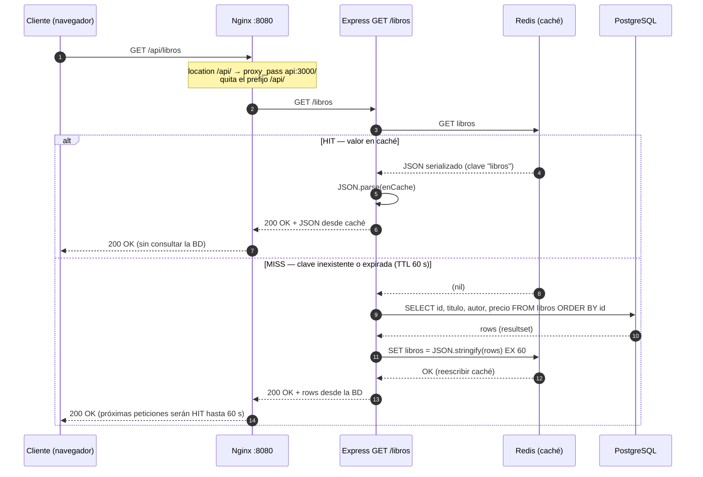
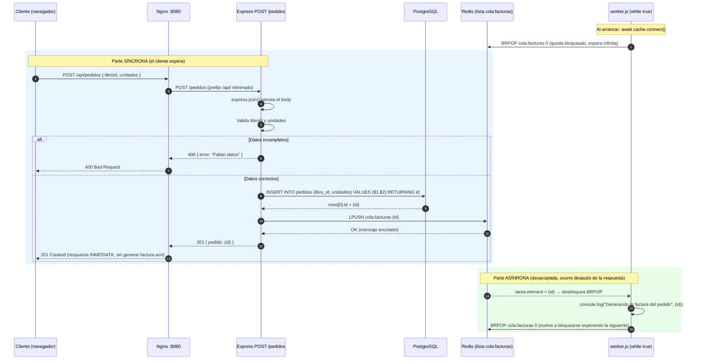

# Diagramas de recorrido — tienda-libros

Basados en `api/src/server.js` y `worker/worker.js`.

**Nota de rutas:** Express monta `/libros` y `/pedidos` (sin prefijo). El prefijo `/api`
lo elimina Nginx (`location /api/ { proxy_pass http://api:3000/; }`), por eso
`GET /api/libros` llega al handler como `GET /libros`.

---

## 1. Lectura `GET /api/libros` — sistema de caché (Hit / Miss)

Patrón *cache-aside* sobre Redis, con TTL de 60 s (`EX: 60`). No existe caché en
memoria local: Redis **es** la caché.

- **Hit (línea 16 de server.js):** `return res.json(JSON.parse(enCache))` → respuesta
  directa, la BD no participa.
- **Miss (líneas 17-19):** consulta SQL, rellena la caché con `EX 60` y responde;
  la siguiente petición dentro de 60 s será Hit.

---

## 2. Escritura `POST /api/pedidos` — cola `cola:facturas` + worker asíncrono

**Claves:**
- La API **nunca habla directamente con el worker**: solo deja el `id` con `LPUSH`
  (línea 29 de server.js). El worker lo retira con `BRPOP` bloqueante timeout `0`
  = espera infinita (línea 9 de worker.js), API de node-redis v4 → `{ element: (id) }`.
- El `201` se responde **antes** de generar la factura → desacoplamiento
  productor/consumidor; si el worker está caído, los pedidos siguen acumulándose en la cola.
- `worker.js` hoy solo hace `console.log` de la factura (no la persiste).
